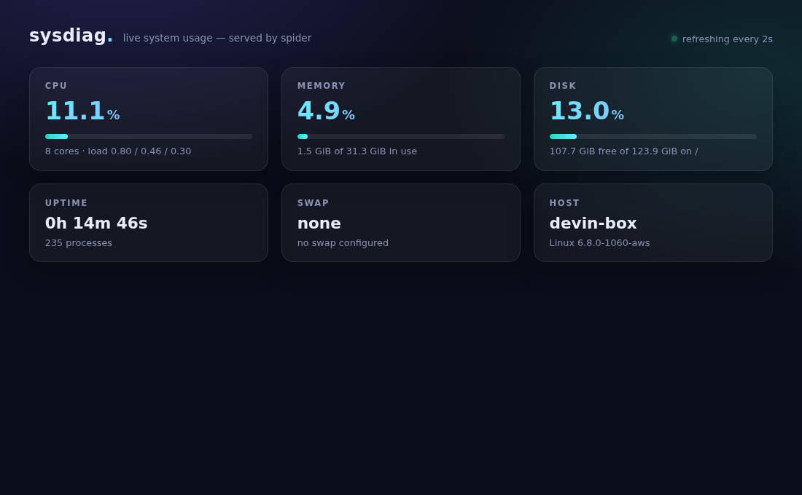

# sysdiag

A single-binary local web dashboard for basic system usage diagnostics, built on
[spider](https://github.com/llllOllOOll/spider) v0.11.0 with HTMX.



## What it shows

- **CPU %** — live delta of cumulative CPU ticks, plus core count and load averages
- **Memory %** — used vs. available physical memory
- **Disk %** — `statfs(2)` on `/`, with free/total
- **Uptime**, process count, **swap**, hostname and kernel version

Runs on **Linux** (metrics from `/proc` + Linux `statfs`) and **macOS** (`sysctl`,
mach `host_statistics`, BSD `statfs`); the backend is selected at compile time and
every field is genuinely measured on both — no placeholders. The macOS backend
doesn't build on spider v0.11.0 for now (see the skill's gotchas).

The page polls a server-rendered HTMX fragment (`GET /metrics`) every 2 seconds.
`GET /api/metrics` returns the same data as JSON. Gauge bars shift from teal to
amber (≥60%) to red (≥85%). Everything — page, htmx, CSS — is embedded in the binary.

## Quickstart (new contributors)

One script proves the whole loop on a fresh clone — setup, build, run, and a
headless-Chrome photo of the live page:

```sh
git clone https://github.com/TanGentleman/zig-legos
cd zig-legos/examples/sysdiag
./quickstart.sh   # 1. setup pinned tools  2. zig build + run  3. rodney screenshot
```

It reuses any Zig `0.17.x`, uv, or Chrome already on your machine and
downloads whatever's missing from the same pinned
[`ci-tools` release](../../scaffolding/ci/README.md) CI uses, cached under `.tools/` (gitignored,
~250 MB on a cold machine, seconds after that). When `quickstart.png` shows
your machine's numbers, everything works — start extending.

The downloaded tools live inside the repo, not on your PATH. To use them in
your own shell afterwards (for `zig build`, `rodney`, …):

```sh
source .tools/env
```

Prefer installing tools yourself? Any Zig 0.17 release (spider v0.11.0's
floor) and any uv work; the script picks
up whatever is on PATH:

```sh
brew install uv          # or: curl -LsSf https://astral.sh/uv/install.sh | sh
uv tool install rodney   # screenshot CLI (optional — quickstart installs it)
# Zig 0.17.1: https://ziglang.org/download/ (exact pin in ../../scaffolding/ci/tools.lock)
```

## Run it

```sh
cd examples/sysdiag
source .tools/env   # skip if zig 0.17.x is already on your PATH
zig build test   # unit tests (parsers, thresholds)
zig build
./zig-out/bin/sysdiag
# open http://127.0.0.1:3000
```

## Proof

[`demo/demo.md`](demo/demo.md) is a [showboat](https://pypi.org/project/showboat/)
document: captured `curl` output from the live server plus a
[rodney](https://pypi.org/project/rodney/) (headless Chrome) screenshot of the page.

CI (`.github/workflows/sysdiag-ci.yml`) builds and tests on Linux, runs the server,
smoke-tests the routes, and uploads a live dashboard screenshot.
Chrome comes from the pinned `ci-tools` release (`ROD_CHROME_BIN`), so rodney
downloads no browser.
